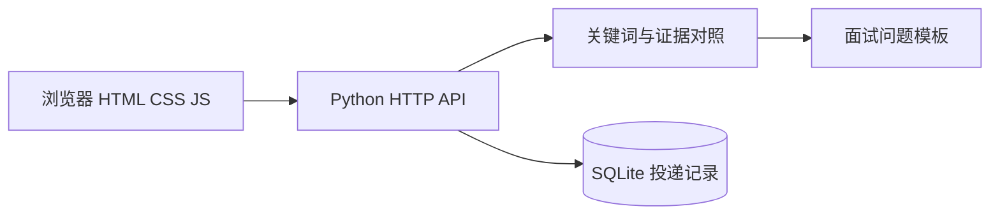

# 起点 Job Workbench

一个用于实习准备的本地 Python 应用。把岗位描述与简历放在一起，展示技术关键词的对应原文，记录投递进度，并生成面试练习提示。

它是**规则工具**，没有调用大模型，不预测录用概率。文字提及不等于掌握技能，覆盖率也不是招聘匹配分。

## 运行

需要 Python 3.10+，没有第三方依赖。

```bash
python app.py
```

浏览器打开 `http://127.0.0.1:8765`。端口冲突时使用 `python app.py --port 8766`。

```bash
python -m unittest discover -s tests -v
```

## 已实现

- 岗位与简历关键词对照，保留两侧原文，避免只有分数没有解释。
- 支持 Python、FastAPI、SQLite、Agent、RAG、LangGraph、工具调用、Codex、Claude Code、DeepSeek 等关键词。
- 投递记录的新增、编辑、删除、搜索、状态筛选与跟进日期。
- SQLite 参数化查询与事务，数据在服务重启后保留。
- 对照报告导出 Markdown，投递记录导出 JSON。
- 根据缺失和已提及技能安排面试练习；不会的技能需要真实学习，不能只修改关键词。
- 输入长度、字段类型、日期、状态、HTTP 请求和数据库操作的自动化测试。

## 设计



`workbench/analysis.py` 处理词表与证据；`workbench/storage.py` 处理持久化；`app.py` 负责 HTTP；`static/` 提供界面。

## 接口

| 方法 | 路径 | 功能 |
| --- | --- | --- |
| GET | `/api/health` | 运行状态 |
| GET | `/api/session` | 获取本机会话令牌 |
| POST | `/api/analyze` | 比较 jd 与 resume |
| GET POST | `/api/applications` | 列表与新增 |
| PUT DELETE | `/api/applications/{id}` | 修改与删除 |

写请求需要页面取得的 `X-Local-Token`。服务只绑定本机地址，不提供用户系统或公网服务能力。

## 局限与后续

内置词表不能识别所有技能，不能理解否定句。例如“不会 Python”仍算文字提及，界面会提醒人工核对。当前没有岗位爬虫、自动投递、语义匹配、云端同步或模型评分。下一步可增加否定语义识别、词表配置和针对真实 JD 的回归样例。

## 开发方式

本项目作为 AI 辅助编程学习作品整理。复现者应亲自运行测试、解释请求链路，并提交自己的功能改进。不要把模板代码或 AI 生成的成果描述成未做过的企业实习。

许可证见 `LICENSE`。
