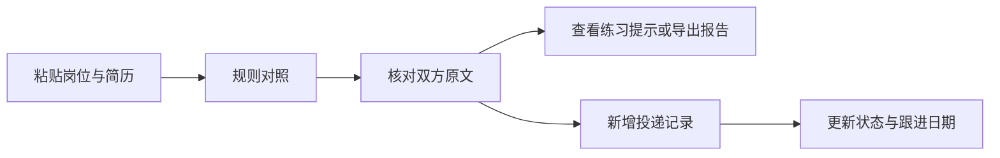

# 起点 Job Workbench 产品需求与验收说明

版本：1.0。本文基于现有学习原型补充整理用户场景、范围取舍和验收规则，采用 AI 辅助编写。目标用户与痛点是待验证假设；尚未开展真实用户访谈、可用性试用或效果数据采集。

## 用户与问题假设

目标用户为正在准备实习的学生。假设他们在查看多个岗位时，需要反复对照要求与自己的经历，且投递状态和后续行动容易分散记录。验证时应先询问其现有做法、最近一次遗漏或重复操作，再判断是否需要本工具。

产品目标是让用户看清岗位与简历中的技术词项证据，并保存每次投递的下一步行动。文字提及不等于技能掌握；工具不预测录用概率。

## 核心流程

对照文本只用于本次分析，不写入投递数据库。用户需要在投递页面手动创建记录，分析结果不会自动转为投递记录。

## MVP 范围与优先级

以下优先级用于说明当前方案的取舍，并非企业项目排期记录。

| 优先级 | 能力及状态 | 取舍理由 |
| --- | --- | --- |
| P0 | 岗位与简历词项对照、原文证据，已实现 | 让用户核对结果依据，避免把单个分数当成能力判断 |
| P0 | 投递记录新增、编辑、删除与本地保存，已实现 | 支持完成一次准备和跟进任务，重启后保留进度 |
| P0 | 输入校验、错误提示与本机使用边界，已实现 | 防止无效输入被当成有效操作，并明确数据保存在本机 |
| P1 | 搜索、状态筛选、跟进日期、报告导出和练习提示，已实现 | 支持多岗位管理和结果复用 |
| 后续 | 否定语义识别、可配置词表，待开发 | 当前“不会 Python”仍会算作文字提及，需要人工核对 |
| 暂不纳入 | 岗位爬虫、自动投递、云同步、录用预测 | 先验证本地对照与记录管理的实际价值 |

## 页面与交互说明

可运行界面见 `static/index.html`、`static/main.js` 和 `static/style.css`。当前未另行制作 Figma 或 Axure 原型。

- 岗位对照页：两个输入区、分析按钮、空结果说明、文字覆盖率、原文证据和 Markdown 导出。文字覆盖率仅以识别出的技术词项为分母。
- 投递记录页：新增记录弹窗、状态筛选、搜索、跟进日期、编辑和删除入口、JSON 导出。首次无记录时展示新增引导。
- 面试练习页：使用最近一次对照生成固定题库与模板提示，没有模型评分或语音面试。
- 失败反馈：请求失败展示错误；保存成功后刷新记录。输入长度、日期和状态由服务端再次校验。

## 验收标准

| 场景 | 操作 | 预期与证据 |
| --- | --- | --- |
| 原文可解释 | 输入仅岗位提到 FastAPI 的虚构文本 | 结果在未提及项保留岗位原文；逻辑见 `workbench/analysis.py` |
| 词项边界 | 只写 JavaScript | 不因子串包含而识别为 Java；有对应自动化测试 |
| 记录保存 | 新增记录后重启服务并重新读取 | 记录仍存在，字段一致；逻辑见 `workbench/storage.py` |
| 非法输入 | 请求提交错误状态、日期或类型 | 返回校验错误，不保存错误数据；接口见 `app.py` |
| 导出复用 | 分析后导出报告，或导出投递列表 | 分别得到 Markdown 和 JSON；界面逻辑见 `static/main.js` |

项目既有 18 项自动化测试通过。测试结果能验证程序行为，尚不能证明用户体验、需求成立或面试成功率。

## 效果指标设计

以下指标尚未采集，埋点和试用记录也尚未实现。

- 对照任务完成率：无需帮助完成“输入、查看原文、指出一项待准备内容”的人数 / 参与该任务的人数。
- 对照耗时：从开始输入到完成原文核对的时间；在相同任务材料下比较手工流程和工具流程，并分别记录。
- 词项误匹配率：人工判错的识别条目 / 人工抽查的识别条目；分别记录否定句、未收录词和边界误匹配。
- 跟进可用性：用户能否找到一条记录并正确修改状态和跟进日期，记录失败步骤及原因。

## 待开展的验证与迭代

计划邀请 3 至 5 位正在准备实习的同学，自愿使用不含个人联系方式的示例材料完成任务。先观察任务过程，再询问结果是否有帮助，避免只问“你喜不喜欢”。小样本只用于发现问题，不用于推断总体市场需求。

匿名记录模板：任务编号、是否完成、耗时、卡住的位置、原话摘录、问题严重程度、改进建议。当前没有填写过的访谈记录或试用结果。

优先验证“文字覆盖率是否被误认为匹配分”和“跟进日期是否容易找到”。获得真实记录后，再决定调整文案、交互或分析规则，并用同一任务复测。
